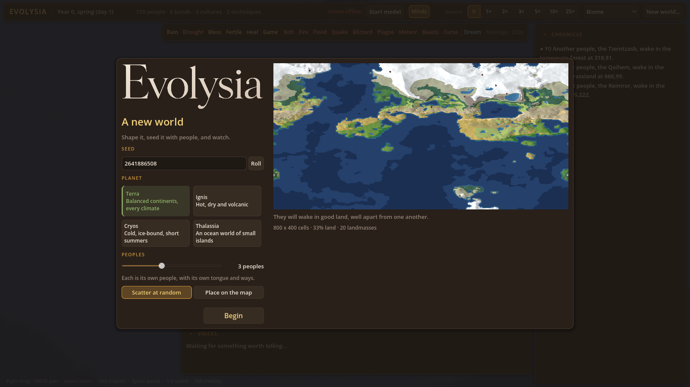
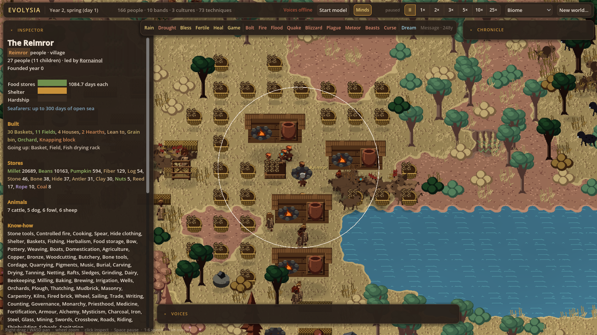

<p align="center">
  
</p>

<p align="center"><strong>A living world. A watchful god. People with other ideas.</strong></p>

<p align="center">
  <a href="https://github.com/TAS-69/Evolysia/releases">Download</a> ·
  <a href="https://github.com/TAS-69/Evolysia/wiki">Wiki</a> ·
  <a href="https://github.com/TAS-69/Evolysia/issues">Report a bug</a>
</p>

Evolysia is a top-down god-game about autonomous people and the worlds they make. Start with scattered bands on a generated planet, watch them learn, settle, trade and quarrel, then decide how much divine intervention is a reasonable amount. The people may disagree.

**Initial alpha: `0.1.0-alpha.1`.** This is a playable simulation prototype. Expect rough edges, changing balance and incomplete content. There is currently **no save/load**, so a world lasts for its session.



## Start playing

1. Download the Windows x64 ZIP from [Releases](https://github.com/TAS-69/Evolysia/releases).
2. Extract the whole folder and run `Evolysia.exe`. Keep its data folder, `Evolysia.pck` and `assets` beside it.
3. Choose a seed, planet and one to six peoples. Scatter them or place them on the map, then select **Begin**.

The Windows package includes its .NET runtime. The Godot editor, Python and model downloads are not required to play. The current renderer requires a Vulkan-capable GPU; other graphics backends and platforms have not been verified for this alpha.

## What's here

- Four planet types: temperate **Terra**, volcanic **Ignis**, frozen **Cryos** and island-covered **Thalassia**, on an 800 × 400 world that wraps east-west.
- Individual genomes, families, needs, emotions, learned fears and changing personalities. People inherit traits, form relationships, invent techniques and sometimes take rejection very personally.
- Migrating bands, emerging cultures, belief, leadership, conflict, farming, herding and dangerous sea journeys.
- Finite timber, stone and ore; 107 goods, 146 gear definitions, 40 processing recipes, 90 structure definitions and 106 techniques. Availability depends on knowledge, surroundings and materials.
- Zoom from a planet map to modular people and settlements, with 16, 32 and 64 pixel artwork densities where available. Clothing pieces have separate main and trim dyes; regional building materials and selected settlements' roof cutaways add detail.
- Seventeen god powers, including rain, healing, disasters, dreams and rare written messages. Inspect people and bands, follow links in their chronicle and see how interventions are remembered.
- Optional local voices and pivotal choices. The ordinary simulation works without them; no model download happens merely by starting the game.



## Controls

| Action | Control |
|---|---|
| Pan | WASD, arrow keys, right-drag or middle-drag |
| Zoom towards the pointer | Mouse wheel |
| Inspect / use an armed power | Left-click |
| Pause / resume | Space |
| Select speed | 1–6: 1×, 2×, 3×, 5×, 10×, 25× |
| Cycle map overlay | Tab |
| Cancel a power / close selection | Esc |
| Collapse a panel | Click its heading |

## Build from source

Use **Godot 4.7.2 .NET**, a .NET SDK capable of building `net8.0`, and **.NET SDK 10** for the runner and tests. The standard Godot download cannot run the C# client. Engine binaries are not stored in this repository.

```powershell
dotnet build game/Evolysia.Game.csproj
dotnet test sim/Evolysia.Sim.slnx -c Release
```

Import `game/project.godot` in the .NET editor and press F5. The client reads the sibling `assets` directory directly. See [Building and testing](docs/wiki/Building-and-testing.md) for export and headless instructions.

Asset generation requires Python 3.11+, Pillow and NumPy:

```powershell
python tools/assetgen/build.py all
python tools/assetgen/validate.py
```

The repository includes 3,614 validated manifest entries across eleven families. Contact sheets regenerate in `assets/_preview` and are excluded from downloads. [Asset pipeline documentation](tools/assetgen/README.md).

## Alpha limits

There is no save/load, multiplayer, direct unit control or in-game outfit editor. Per-container item identities, fully simulated cargo logistics, the complete specialist-building catalogue, magic and space gameplay remain development work. Stored contents are representative visuals over quantity-based inventories. Some catalogue entries have no dedicated game visual, and some close views enlarge base sprites. Roads, cliff rendering, the final UI icon set and portrait integration are incomplete.

Higher speed settings are targets; large populations can run slower. Automated checks cover simulation rules, determinism and artwork contracts, not centuries of balanced play or every GPU. [Known limitations](docs/wiki/Known-limitations.md) and [alpha notes](docs/releases/v0.1.0-alpha.1.md) describe the current scope.

## Licence

Code and documentation text: [MIT](LICENSE), copyright © 2026 **TAS-69**. Original artwork, palettes, logo and branding: [all rights reserved](ART-LICENSE.md), with permission for playing official builds and sharing gameplay footage. Third-party dependencies retain [their own licences](THIRD_PARTY_NOTICES.md).
